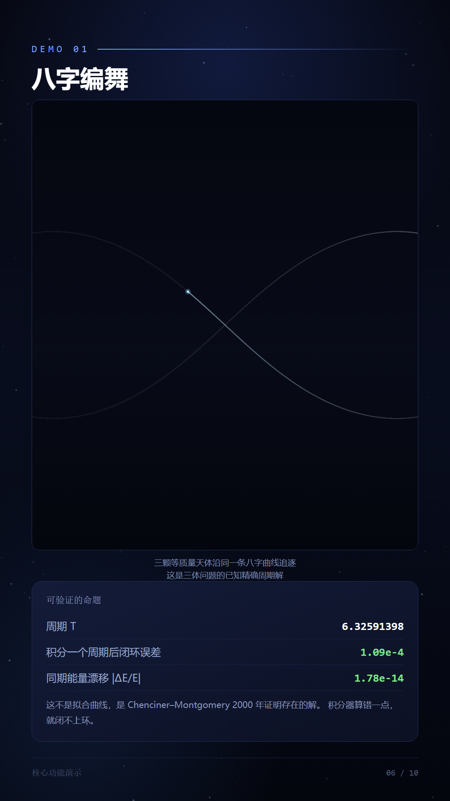
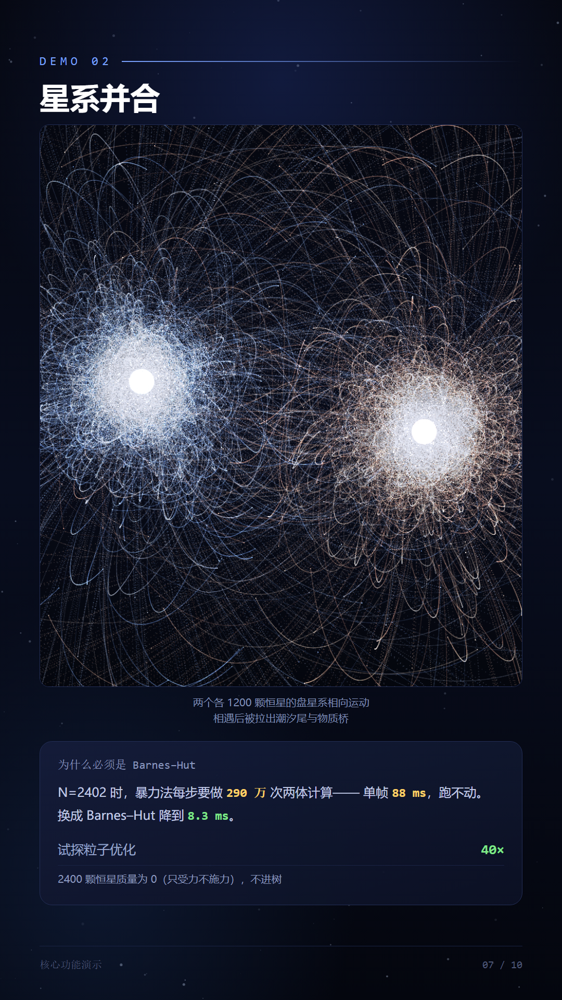
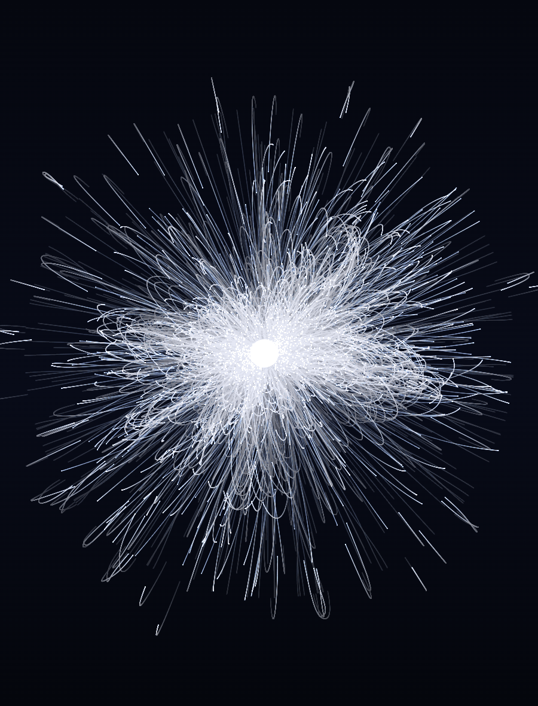
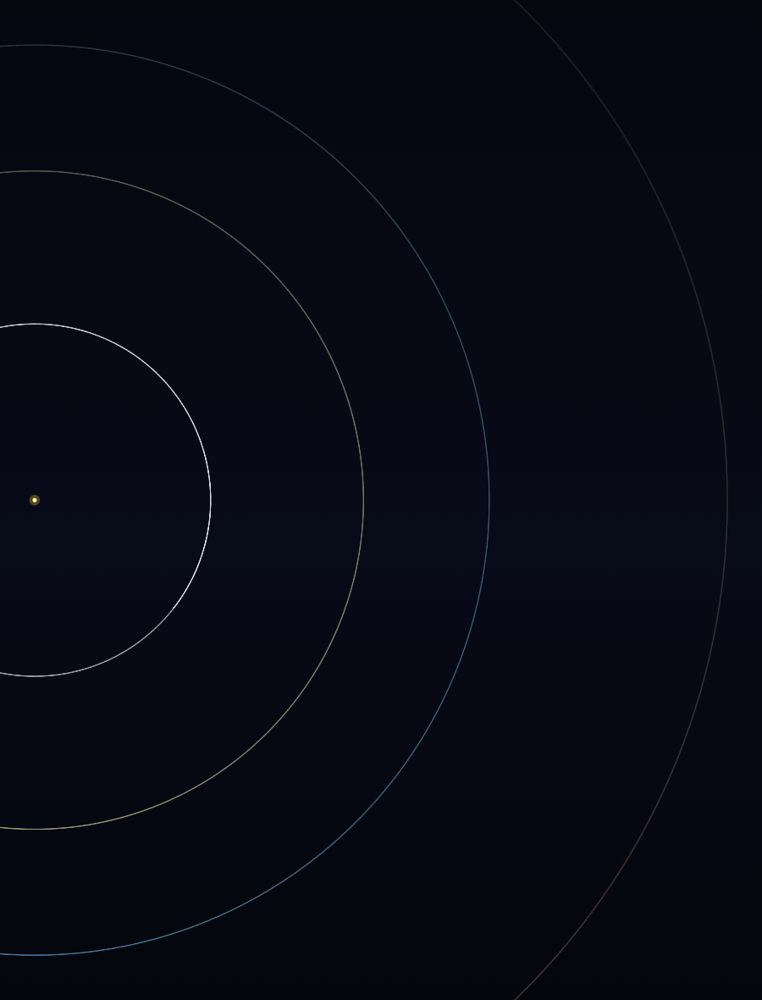
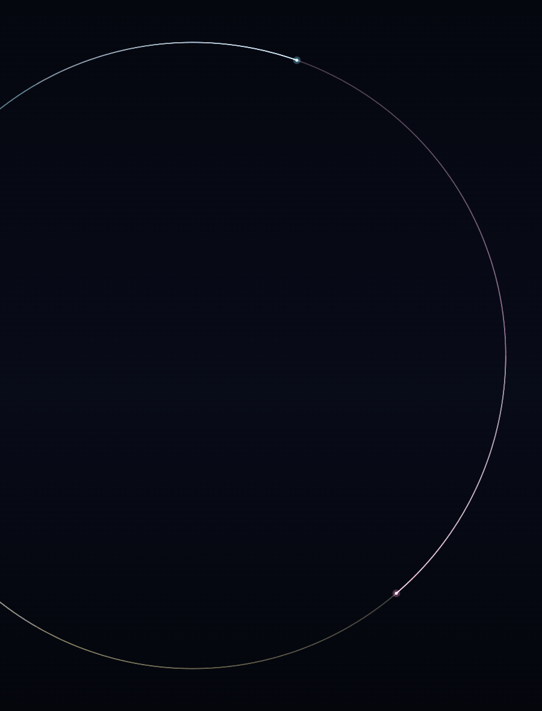
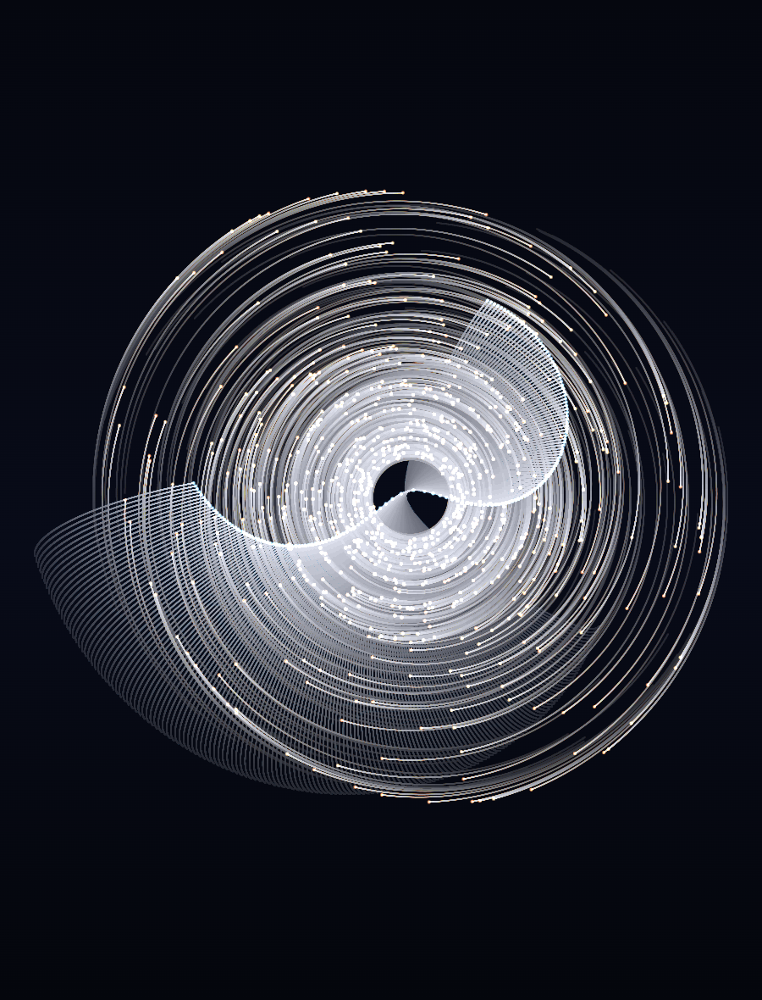
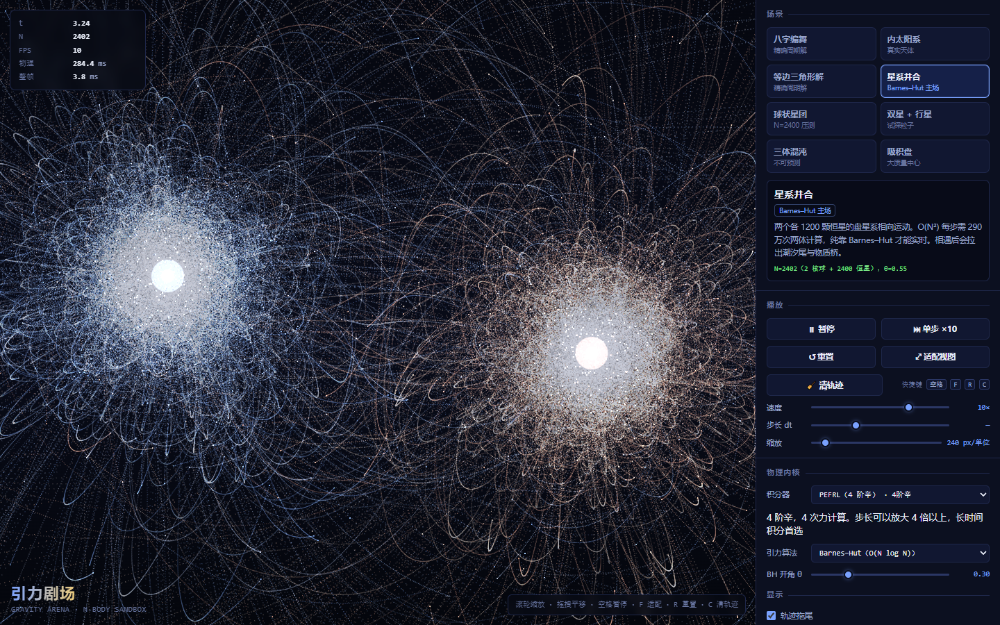

<div align="center">

# 引力剧场 · Gravity Arena

**用 Barnes–Hut 树与辛积分器驱动的 N 体引力沙盒**
每一个数字都能被守恒量与解析解验证

零依赖 · 单文件 HTML · 双击即开

</div>

---

## 什么是它

一个跑在浏览器里的 **N 体引力求解器**。数千个天体在共同的引力场中运动，实时展示轨道、潮汐尾、星系并合与三体混沌。

它和一般的"引力玩具"有一处根本不同：

> **每个场景都绑定一个可证伪的物理命题** —— 要么对应真实天体数据，要么对应已发表的精确解。
> 所以它可以被验证，而不只是"看着对"。

### 三个能当标准答案的场景

| 场景 | 命题 | 实测 |
|---|---|---|
| **八字编舞** | 三体问题的已知周期解（Chenciner–Montgomery 2000） | 积分 T=6.32591398 一个周期后，闭环误差 `1.09e-4` |
| **等边三角形解** | ω² = 3Gm/a³ 的精确周期解 | 三颗星永远保持 120° 均分 |
| **内太阳系** | 4π² 单位制下地球公转周期恰为 1 年 | 水金地火真实半长轴与质量 |

---

## 核心功能

### 引力求解
- **暴力法 O(N²)** —— 既是可用算法，也是 Barnes–Hut 的**黄金标准**（用来对拍）
- **Barnes–Hut 四叉树** —— 单极近似，开角 θ 可调；O(N log N)
  - 包围盒自包含测试，杜绝自作用误差
  - 试探粒子不进树（星系场景提速 **40×**）
  - 树在一个积分步内复用（省 3/4 建树开销）
- **Plummer 软化** ε —— 消除近距离奇点

### 四种时间积分器，实时切换

| 积分器 | 阶 | 性质 | 力计算/步 | 谐振子实测阶 |
|---|---|---|---|---|
| 半隐式 Euler | 1 | 非辛 | 1 | 1.03 |
| Velocity Verlet | 2 | **辛** | 2 | 2.00 |
| **PEFRL**（Omelyan 2002） | 4 | **辛** | 4 | **4.00** |
| 经典 RK4 | 4 | 非辛 | 4 | 5.00 |

**辛 vs 非辛**是本项目最核心的物理主张。三体混沌系统 t=40 时的 |ΔE/E|：

```
半隐式 Euler    2.21e-5   误差随时间累积
经典 RK4        3.53e-6   误差随时间累积
Velocity Verlet 5.04e-8   误差有界振荡
PEFRL           9.25e-14  误差有界振荡
```

最差与最好差 **5×10⁸ 倍**。辛方法的能量误差有界振荡、长期积分不累积——这才是长时模拟能不能做的分界线。

### 八个预设场景

| 场景 | N | 类型 | 引力算法 |
|---|---|---|---|
| 八字编舞 | 3 | **精确周期解** | 暴力 |
| 内太阳系 | 5 | 真实天体 | 暴力 |
| 等边三角形解 | 3 | **精确周期解** | 暴力 |
| 星系并合 | 2402 | Barnes–Hut 主场 | Barnes–Hut |
| 球状星团 | 2401 | N=2400 压测 | Barnes–Hut |
| 双星 + 行星 | 7 | 试探粒子 | 暴力 |
| 三体混沌 | 3 | 不可预测 | 暴力 |
| 吸积盘 | 1061 | 大质量中心 | Barnes–Hut |

### 实时诊断
面板同时显示 ΔE/E、ΔL/L、ΔP/P、质心漂移、动能 T、引力势能 U —— 调参时守恒量是否被破坏，一眼可见。

### 交互
场景切换 · 播放/暂停/单步/重置 · 速度（0.1–60× 对数映射）· 步长 dt · 积分器切换 ·
引力算法切换 · BH 开角 θ · 滚轮缩放 · 拖拽平移 · 轨迹拖尾 · 速度矢量 · 光晕 · 视图自适应

快捷键：`空格` 播放/暂停　`F` 适配　`R` 重置　`C` 清轨迹

---

## 成果展示

### 八字编舞

三个等质量天体沿同一条八字曲线追逐 —— 这是三体问题已被证明存在的周期解。



### 星系并合

两个各 1200 颗恒星的盘星系相向运动。O(N²) 每步需 290 万次两体计算，单帧 88 ms 根本跑不动；换成 Barnes–Hut 降到 8.3 ms。



### 球状星团（2400 颗恒星）

大质量中心星 + 2400 颗恒星，指数分布密度。



### 内太阳系



### 等边三角形解



### 吸积盘



### Barnes–Hut 的精度与加速

精度 vs 开角（N=200，与暴力解逐点比对）：

| θ | 相对力误差 |
|---|---|
| 0.2 | 0.68% |
| 0.4 | 3.48% |
| 0.6 | 12.54% |
| 0.8 | 21.83% |

log-log 斜率 **2.56**，与单极截断的理论标度 ≈ 2 吻合。

实测加速比（单线程 · Verlet 积分 · Node 22）：

| N | 暴力 O(N²) | Barnes–Hut | 加速 |
|---|---|---|---|
| 500 | 2.5 ms | 1.2 ms | 2.1× |
| 1000 | 9.8 ms | 2.3 ms | 4.1× |
| 2000 | 39 ms | 5.2 ms | 7.5× |
| 3000 | 88 ms | 8.5 ms | 10.6× |

### 完整界面



### 9:16 竖屏图文

`slides-png/` 下有 10 张 1080×1920 的抖音比例图文，按「项目简介 → 核心功能 → 演示 → 成果与验证」组织。

---

## 安装与运行

### 依赖
**无运行时依赖。** 任意现代浏览器即可。

```bash
# 直接打开，不需要服务器、不需要装包
start index.html        # Windows
open  index.html        # macOS
```

> 源码用的是 classic script 而非 ES module —— 因为 `file://` 下 ES module 会被 CORS 拦。
> 这是为了"双击即开"这个需求刻意做的取舍。

### 跑验证

```bash
# 物理层：41 条断言（纯 Node，约 8 秒，无需浏览器）
node test/verify-node.mjs

# 浏览器层：54 条断言 + 16 张截图（约 3 分钟）
node test/verify-browser.mjs
```

浏览器测试需要 Playwright：

```bash
npm i -D playwright
npx playwright install chromium
```

> 脚本顶部用 `createRequire` 加载 Playwright，因为 **ESM 不认 `NODE_PATH`**。
> 若路径不同，改 `test/verify-browser.mjs` 顶部的 require 即可。

### 重新生成图文

```bash
node tools/collect-data.mjs    # 采集物理数据 → slides-data.json
node collect-asserts.mjs       # 跑两套验证 → 采集真实断言数
node slides-gen.mjs            # 生成 10 张幻灯片 HTML
node shots-render.mjs          # 渲染 PNG（含重叠检测）
```

**必须按顺序**：`slides-data.json` 是所有展示数字的唯一来源。
手写数字比没有数字更糟——本项目曾手写"87 项断言"，实测是 95。

---

## 项目结构

```
gravity-theater/
├── index.html                  应用入口（双击即开）
├── PROJECT.md                  给 AI 接手用的项目说明
├── README.md                   本文件
│
├── src/
│   ├── core.js                 命名空间、数学工具、确定性 PRNG
│   ├── integrators.js          4 种时间积分器
│   ├── bh.js                   Barnes–Hut 四叉树
│   ├── sim.js                  模拟器 + 暴力引力 + 守恒量诊断
│   ├── presets.js              8 个预设场景
│   ├── render.js               Canvas 2D 渲染
│   └── app.js                  主循环、交互、UI、GA_APP 调试 API
│
├── test/
│   ├── verify-node.mjs         41 条物理断言
│   └── verify-browser.mjs      54 条浏览器断言 + 截图
│
├── tools/
│   ├── collect-data.mjs        采集物理数据
│   └── collect-asserts.mjs     采集真实断言数
│
├── slides-gen.mjs              生成 9:16 幻灯片
├── shots-render.mjs            幻灯片渲染 + 重叠检测
├── slides-data.json            展示数字的唯一来源
├── slides/                     10 张幻灯片 HTML
├── slides-png/                 10 张幻灯片 PNG（1080×1920）
└── shots/                      应用截图（横版 + 竖版 + 整页）
```

---

## 验证体系

**95 条断言，全部通过。** 分两层：

### 物理层（41 条，纯 Node）
断言的是**物理定律本身**，不是"像素好不好看"：

- 开普勒圆轨道与解析解**逐点比对**（不用终点误差——那是相位差，不是离散误差）
- 四个积分器的实测收敛阶符合理论（1.03 / 2.00 / 4.00 / 5.00）
- 辛方法能量误差有界振荡、非辛单调累积
- Barnes–Hut 误差随 θ 按 O(θ²) 收敛（log-log 斜率 2.56）
- BH 长时间轨迹与暴力解一致，且**θ 收紧则偏差单调下降**（区分"截断误差"与"代码 bug"的判据）
- 动量 / 角动量守恒到浮点精度
- 试探粒子语义正确（不受力但受力）
- 软化长度消除奇点（重合粒子不产生 Infinity）
- 同种子两次运行**逐位一致**（确定性）

### 浏览器层（54 条，Playwright）
- `file://` 直开可用、无 JS 错误
- 画布**真的画出了东西**（量像素：不纯黑、有高亮像素、颜色有层次）
- 八个场景全部可加载可推进、能量均有限
- 辛/非辛在浏览器内复现
- Barnes–Hut 加速比在浏览器内实测
- UI 控件点击真实 DOM 生效（场景按钮 / 播放 / 滑块 / 下拉 / 滚轮）
- 实际帧率与物理单步耗时

### 权威对照

PEFRL 在谐振子基准上的误差为 **7.206e-7 / 2.822e-9**（h/T = 0.02 / 0.005），
与 UCSD Physics 141 讲义原表**逐位吻合**。这是判断实现是否正确的最强证据。

---

## 这套验证抓出过的真 bug

诚实记录，因为它们比"一次写对"更有价值：

| Bug | 症状 | 根因 |
|---|---|---|
| RK4 位置被累加四次 | 有效步长放大 3 倍，轨道飞掉 | 暂存 x₀ 后没备份，最终加权写到了已更新的 x 上 |
| PEFRL 收敛阶退化 | 4 阶变 1 阶，误差差 75000 倍 | 系数 λ 记成正号；且求值顺序写成"先算力再漂移" |
| Barnes–Hut 总质量翻倍 | 单轴构型下受力为 0 | 节点分裂时父节点未清零，父子重复计入 |
| 视口缩放退化 | 内太阳系全黑 | 共线构型下包围盒高度为 0，`cover` 算出 10⁶ 缩放 |
| 轨迹采样缺口 | 速度 >1 时轨迹变虚线 | 一帧只打一个点，必须逐积分步打 |
| 测试自我欺骗 | 三种积分器测出相同误差 | 切换积分器前没重新加载场景，drift 被累积 |

---

## 已知限制

1. **大 N 场景用 Verlet 而非 PEFRL** —— PEFRL 开销是 Verlet 的 2.04×（4 次力 vs 2 次），
   N=2500 时 13.3ms vs 6.5ms。60FPS 只能选 Verlet。这是架构性取舍。
2. **无 3D** —— 算法是二维的。三维推广数学上直接，但渲染与交互需重做。
3. **无天体碰撞/合并** —— 软化处理了近距离，但没有物理并合事件。
4. **BH 只用单极近似** —— 精度上限 ~O(θ²)，θ=0.5 时约 3.5% 力误差。
   要更高需加四极矩项。
5. **性能数字有 ±0.2× 抖动** —— 取决于机器负载。表格里是单次实测值。

---

## 参考

- Chenciner & Montgomery (2000) — 八字编舞周期解
- Omelyan, Mryglod & Folk, *Comput. Phys. Commun.* 146 (2002) 188 — PEFRL
- UCSD Physics 141 讲义 Eq.(34) — PEFRL 九段序列与谐振子基准表
- Barnes (1986) / Hut (1986) — 四叉树聚合与层级聚合近似

---

## 许可

MIT
